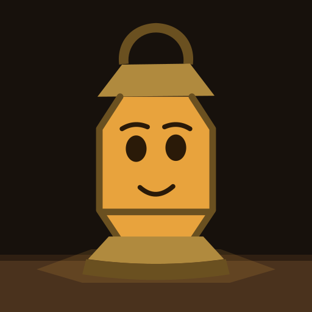
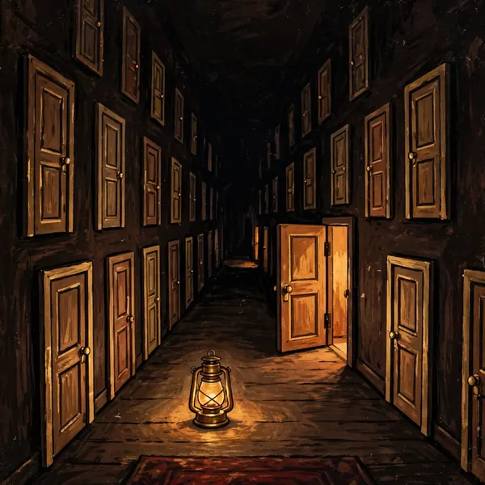
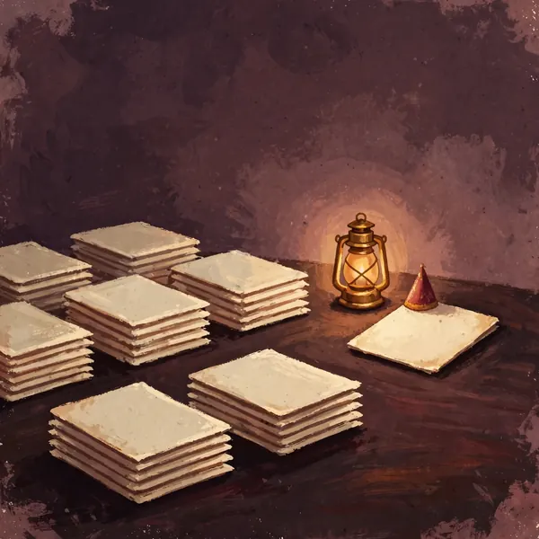
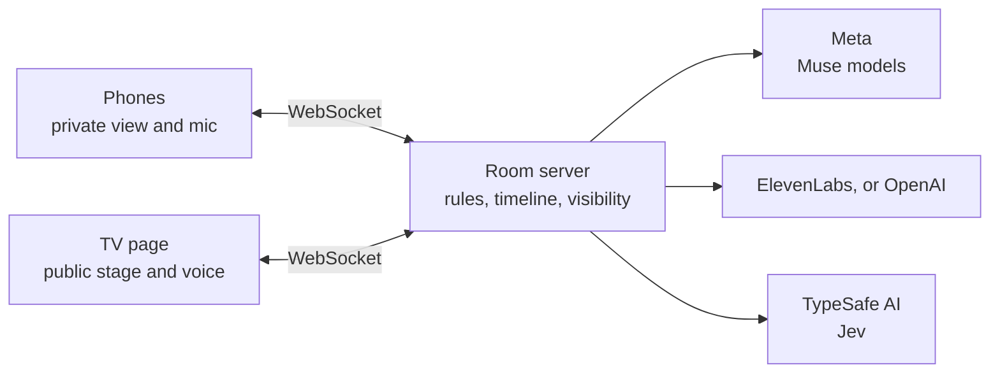

<p align="center">
  
</p>

<h1 align="center">Funhouse</h1>

<p align="center">
  <strong>Game night that runs itself.</strong><br />
  An AI host on your TV. Phones as controllers. Nothing to install.
</p>

<p align="center">
  <a href="https://funhouse.live">Play at funhouse.live</a> ·
  <a href="#quickstart">Host your own</a> ·
  <a href="#how-it-works">How it works</a> ·
  <a href="LICENSE">MIT licence</a>
</p>

<p align="center">
  
  
  
  
  
</p>

Funhouse is a party-game platform. Open it on a TV, everyone scans a QR code, and Marlowe, a brass lantern, runs the night out loud: hearing each player on their own phone, judging answers, painting pictures and keeping secrets. The rules are code, so the host can't override a score or a vote.

Built for the Meta Global AI Developer Hackathon (Indie Developer track). The first commit is dated Nov 1, 2026, and everything here was written after it. This is an independent project, not made or endorsed by Meta.

## Quickstart

You need Docker with Compose, or Podman with `podman compose` and a Compose provider. The whole platform runs in one container.

### Try it with no keys

This costs nothing. A rule-based stand-in replaces the AI host, so you type instead of talk, with no voice or paintings. It shows the room, rules and screens, not how good the real host is.

```bash
git clone https://github.com/AmbroseNilam/funhouse.git
```

```bash
cd funhouse
```

```bash
docker compose -f compose.yaml -f compose.demo.yaml up --build
```

Open <http://localhost:8740> on this machine and choose to host. To join from a second tab, use the room's code. To bring in real phones, see [Phones on your network](#phones-on-your-network).

The stand-in answers yes or no by the length of your question, so don't try to solve Twenty Doors with it. Quizmaster uses its small built-in question bank.

### Run it for real

```bash
cp .env.example .env
```

Add your keys to `.env` ([which ones](#keys-and-cost)) and set `PUBLIC_URL`, then:

```bash
docker compose up --build
```

With Podman, write `podman compose` in place of `docker compose`. The image is pinned to a specific Node build, runs as a non-root user on a read-only filesystem with all capabilities dropped, and holds no secrets: keys are passed in when it starts. Rooms live in memory, so a restart ends them.

## Phones on your network

`PUBLIC_URL` is the address in the QR code, **and the only page address allowed to connect**. Open the TV page at exactly that address. A TV page opened at `localhost` won't connect if `PUBLIC_URL` is your network address.

Phones only allow the microphone on HTTPS, so choose one of these:

| Option | Mic on phones | Set `PUBLIC_URL` to | Notes |
| --- | --- | --- | --- |
| Plain network | No, players tap **Type instead** | `http://YOUR-LAN-IP:8740` | Simplest, and everything else works. Phones must be on the same network. Find the address with `ipconfig getifaddr en0` on a Mac or `hostname -I` on Linux. |
| [Tailscale Serve](https://tailscale.com/kb/1312/serve) | Yes | `https://your-machine.your-tailnet.ts.net` | Run `tailscale serve --bg 8740`. Every phone needs Tailscale on your tailnet. Stays private. |
| [Cloudflare Tunnel](https://developers.cloudflare.com/cloudflare-one/connections/connect-networks/) | Yes | The tunnel's HTTPS address | `cloudflared tunnel --url http://localhost:8740` needs no account. **It's on the public internet, so anyone with the address can spend your keys.** |
| Local certificates | Yes | `https://YOUR-LAN-IP` | Put a proxy such as Caddy in front, using [mkcert](https://github.com/FiloSottile/mkcert). Every phone must install and trust your certificate authority, so this is the most work. |

For example, with no keys on a plain network:

```bash
PUBLIC_URL=http://192.168.1.20:8740 docker compose -f compose.yaml -f compose.demo.yaml up --build
```

We ran the plain network path. The three HTTPS options are written from each tool's documented behaviour and have not been run against this compose file. Changing `PUBLIC_URL` needs a restart.

## Keys and cost

Your keys pay for your games. Nothing is billed through this project. Providers charge you directly, so set a spending limit with each one.

| Key | Needed? | What it does | Without it |
| --- | --- | --- | --- |
| `META_MODEL_API_KEY` | **Required** for real play | Host, questions, hearing, paintings, search | The server starts and rooms open, but the host can't reply. Use the demo instead. |
| `ELEVENLABS_API_KEY` | Recommended | The host's voice | OpenAI's voice is used. |
| `OPENAI_API_KEY` | Recommended | Stands in for any line ElevenLabs can't start, and is the voice with no ElevenLabs key | With neither voice key, the host's lines show as captions, with no sound. |
| `JEV_API_KEY` | Optional | Quick judgments, such as whether two answers match | Code fallbacks are used. |

Create the Meta key at [dev.meta.ai](https://dev.meta.ai). Pictures cost about a cent each, with at most 40 per room. Other costs depend on how much your group talks, and we haven't measured a typical night, so watch your provider dashboards the first time.

The server stops spending for the day at 5,000 model replies, 2,000 voice lines, 200 pictures, 4,000 recorded lines and 1,500 AI guest decisions. These counters reset when it restarts, and microphone transcription isn't counted, so **don't leave a public address open unattended** unless you turn on dollar limits.

### Dollar limits for a public site

Off by default. With `COST_LIMITS=1` every paid call is counted in dollars, using provider usage where it's returned and the estimates in the price table at the top of `providers/meter.ts`. These are estimates, so also set limits with your providers. Spending is charged to the address that opened the room, saved to `COST_DIR`, and reset daily. As an allowance runs down, new paintings stop at 60%, voice turns to captions at 90%, and at 100% the room finishes its sentence and shows a stop screen. If the store breaks, spending stops but the server stays up. Rooms close after `COST_IDLE_MINUTES` with no person doing anything.

The visitor's address comes from `CF-Connecting-IP` only when the connection arrives from this machine, as it does through a Cloudflare Tunnel sidecar. Behind any other proxy, every visitor looks like the proxy. Someone rotating VPN addresses gets a new allowance each time, which only the site ceiling stops.

## Games

These are the games on the shelf, each set by `level` in `studio/games/<id>/game.meta.json` or in `cartridges/`.

| Game | Players | What happens |
| --- | --- | --- |
| Twenty Doors | 1 to 12 | Marlowe holds a secret. Ask yes-or-no questions, and each answer opens one of twenty doors. |
| Quizmaster | 1 to 12 | Name any topic. Marlowe writes the questions, with four answers to tap or speak, and keeps score. |
| Same Page | 3 to 8 | Marlowe asks. Everyone writes one short answer, and the matching ones stack up. |
| Werewolf | 4 to 10 | Secret roles on your phone. Argue out loud by day and vote on your phone. The host is never told who is what. |
| Painted Whispers | 3 to 8 | You write a line and Marlowe paints it. The next person sees only the painting and describes it. |

More games are in the repository but held back from the shelf. `STUDIO_SHOW_HELD=1` shows them, marked Testing. They're unfinished.

## How it works



Every fact has a visibility scope, so a secret role reaches only its owner's phone and the model isn't told what it shouldn't know. The host wakes only on events.

### Models

| Provider | Model | Used for | Code |
| --- | --- | --- | --- |
| Meta | Muse Spark 1.3 | The host, and writing game content | `providers/meta/spark.ts` |
| Meta | Muse Spark 1.2 | Filtering typed text and web search for quiz questions | `providers/meta/moderation.ts`, `search.ts` |
| Meta | Muse Voice Transcribe 1.0 | One realtime session per phone, so the room knows who said what | `providers/meta/transcribe.ts` |
| Meta | Muse Image 1.0 | Paintings, such as the Twenty Doors reveal and Painted Whispers | `providers/meta/image.ts` |
| Meta | Muse Wonder 1.0 | Offline only: fact-checks the built-in question banks, run by hand | `tools/fact-check.ts` |
| TypeSafe AI | Jev 1.14.0 | Quick judgments a wrong answer can't hurt, with code to fall back on. Never a win, score, vote or secret. | `room/decide.ts` |
| ElevenLabs | Text to speech | The host's voice. Meta has no speech output. | `providers/elevenlabs/` |
| OpenAI | Text to speech, Realtime | Voice fallback, and the voice with no ElevenLabs key | `providers/openai/` |

Paintings and the host's words and voice are AI-generated. The lantern, icons and share image are drawn in code.

### Layout

| Path | Owns |
| --- | --- |
| `room/` | The runtime: HTTP and WebSocket server, event timeline, visibility scopes, host loop |
| `shared/` | The vocabulary both sides agree on: scenes, controls, events, the cartridge contract |
| `screen/`, `phone/`, `landing/` | The TV stage, the phone stage and the front door |
| `cartridges/` | Hand-written games: a manifest and a rules core |
| `studio/` | Games as data: kits, blueprints and the rehearsal harness |
| `providers/` | Provider clients. Their details never leak past this folder. |
| `tools/` | Probes, scripted games, the stand-in host and `verify.py` |
| `deploy/`, `compose*.yaml` | The container image and how to run it |

## Configuration

Set these in `.env`. Each switch is off unless set to `1`.

| Variable | Effect |
| --- | --- |
| `PORT` | Port published on this machine (default `8740`). If you change it, change `PUBLIC_URL` to match. |
| `PUBLIC_URL` | Address in the QR code and the only page address allowed to connect (default `http://localhost:8740`) |
| `AGENTS_ON` | Lets players invite their own AI agent to a seat through a link |
| `GUESTS_OFF` | Removes AI guests, which otherwise can fill empty seats in games that support them |
| `WEB_SEARCH_OFF` | Games get only what the model writes from memory |
| `QUIZ_OPEN_ANSWERS` | Quizmaster takes spoken answers instead of four choices |
| `STUDIO_SHOW_HELD` | Shows held games on every shelf |
| `GAME_ROOM_TEXT_ONLY` | No voice, mic or paintings. Muse Spark still replies if you have a key. |
| `GAME_ROOM_DRAW` | Paints even in text-only mode |
| `JEV_DECISIONS_OFF` | Comma-separated Jev judgments to turn off |
| `GEO_RULES` | Applies Cloudflare location rules through a tunnel: refuses territories in `room/geo.ts`, keeps paintings off for India |
| `COST_LIMITS` | Turns on dollar limits; needs `COST_DIR`, a writable folder |
| `COST_ADDRESS_DOLLARS` / `COST_SITE_DOLLARS` | Daily allowance per address (default 2) and ceiling for the site (default 15) |
| `COST_PAINTINGS_OFF_AT` / `COST_CAPTIONS_AT` | Fractions where paintings stop and captions start (defaults 0.6, 0.9) |
| `COST_RESET_UTC_HOUR` | Hour the day resets (default 8) |
| `COST_IDLE_MINUTES` | Closes a room after this long with no person active (default 5) |
| `COST_TRANSCRIBE_SECONDS_ADDRESS` / `_SITE`, `COST_JEV_CALLS_ADDRESS` / `_SITE` | Daily audio and Jev caps |
| `COST_JUDGE_CODE` / `COST_JUDGE_DOLLARS` | A code people can enter for a higher allowance (default 10) |
| `COST_OWNER_CODE` | Exempts its holder from limits, and reads `/owner/spend` through an `x-owner-code` header |
| `COST_ALERT_URL` | Optional webhook told when the site passes a stage |

## Development

Requires Node 24 and npm.

```bash
npm install
```

```bash
npm run build
```

```bash
npm run room
```

To play a whole game from a script, with no keys, run each of these in its own terminal:

```bash
node tools/stub-model.ts
```

```bash
META_BASE_URL=http://localhost:8799 META_MODEL_API_KEY=<any text> GAME_ROOM_TEXT_ONLY=1 npm run room
```

```bash
node tools/scenarios/twenty-doors.ts
```

## Contributing

Issues and pull requests are welcome. Read `CLAUDE.md` for the code conventions and `DESIGN.md` before changing anything a player sees. Before committing, run:

```bash
npm run check
```

Logs must never hold what anyone said, what the host replied or a player's name.

## Licence

MIT. See [LICENSE](LICENSE). Fraunces is under the SIL Open Font License.
